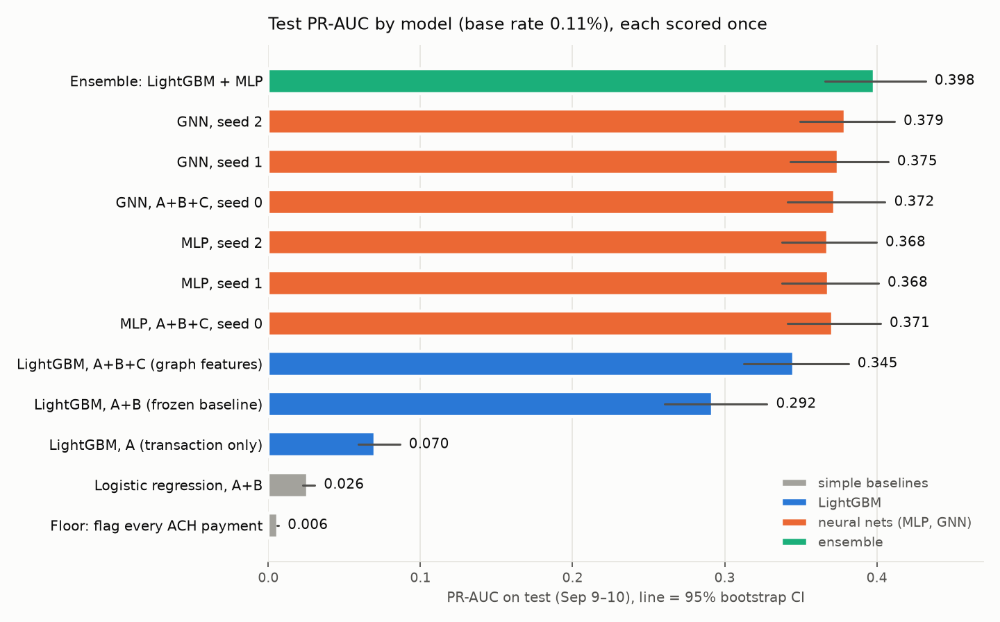
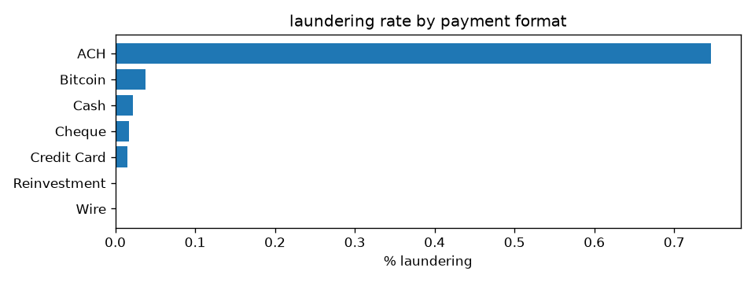
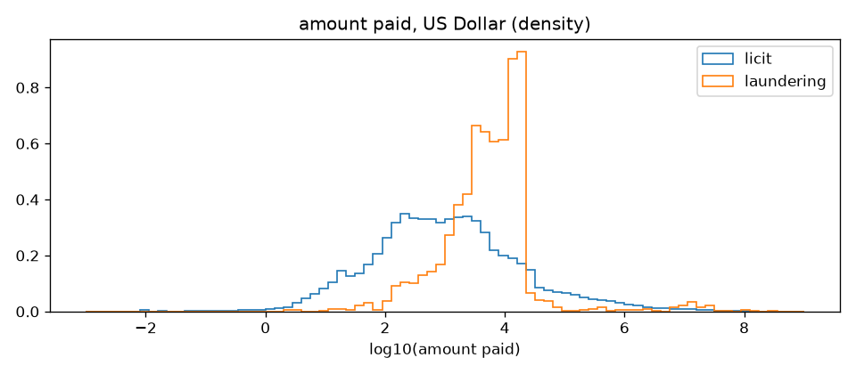
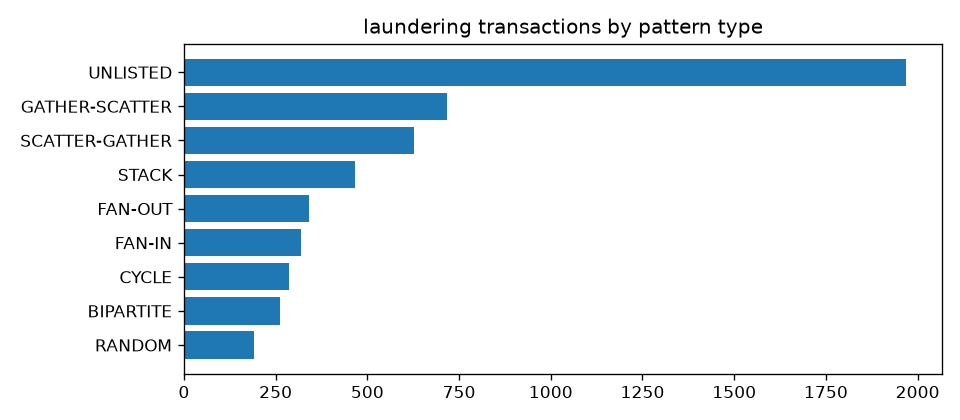
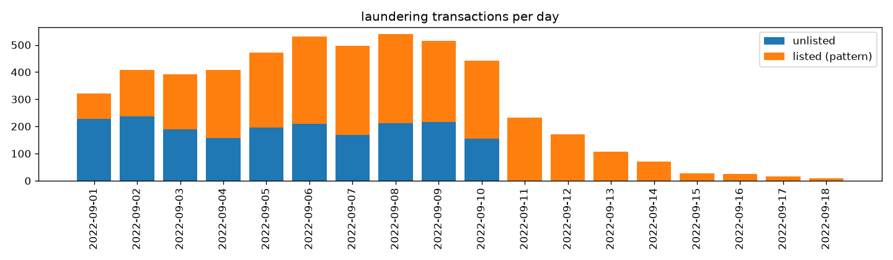

# 💸 Money Laundering Detection

**Flags laundering transactions in 5.1M bank transfers using only what a bank knows at the moment of each payment: trees, a graph neural network and an ensemble, on IBM's synthetic AML dataset.**

     

The headline question is an ablation: **do graph features (who pays whom, money passing through, short cycles) beat per-transaction and per-account behaviour features?** The rules are strict on purpose: a time split, features from strictly earlier transactions only, no account IDs, and each test set scored once.



## Results at a glance

| Model (test, Sep 9–10) | PR-AUC [95% CI] | Precision / recall at 500 alerts/day |
|---|---|---|
| Floor: flag every ACH payment | 0.006 | 0.004 / 0.004 |
| LightGBM, transaction features only (A) | 0.070 | 0.151 / 0.158 |
| LightGBM, + account behaviour (A+B) | 0.292 [0.261, 0.328] | 0.337 / 0.353 |
| LightGBM, + graph features (A+B+C) | 0.345 [0.313, 0.381] | 0.389 / 0.407 |
| MLP on A+B+C, 3 seeds | 0.369 ± 0.002 | 0.369–0.382 / 0.386–0.400 |
| GNN on A+B+C, 3 seeds | 0.375 ± 0.003 | 0.377–0.386 / 0.394–0.404 |
| **Ensemble: LightGBM + MLP** | **0.398** [0.366, 0.432] | **0.395 / 0.413** |

- **Graph features help.** Adding hand-made graph features to LightGBM gives **+0.053 PR-AUC** on test (paired bootstrap CI [0.024, 0.080]), significant under both row-level and attempt-cluster resampling. The same holds on val (+0.051).
- **A graph neural network adds nothing on top.** A GNN with message passing and an MLP with the same inputs and head score the same (paired difference per seed: +0.002 / +0.006 / +0.011 on test, never significant). Once the graph is summarised into features, learning more from the graph structure doesn't pay.
- **Blending a tree model with a neural net gives the best result.** It beats both of its parts on test (+0.053 over LightGBM, +0.027 to +0.030 over each MLP seed, all significant). At the operating point the gain is small: 0.395 vs 0.389 precision at 500 alerts a day.
- **A third of laundering is out of reach.** 38% of laundering rows belong to no listed scheme ("UNLISTED"), and every model, ours and the published ones, catches about 1–3% of them.
- **Published scores are higher because their models see future transactions.** Give our own LightGBM the same look-ahead and it matches IBM's GNN (see [the comparison](#how-this-compares-with-published-results)).

## The data

IBM's AMLworld simulator generates people, companies and banks, and a criminal minority who launder money through eight scheme shapes. Every transaction carries a ground-truth label, and a separate file lists the scheme attempts.

| | |
|---|---|
| Transactions | 5,078,345 over Sep 1–18, 2022 (99.98% on Sep 1–10) |
| Laundering | 5,177 (0.10%) |
| Accounts | 515,088 (bank + account) |
| Listed scheme attempts | 370 in 8 types: fan-in, fan-out, gather-scatter, scatter-gather, cycle, stack, bipartite, random |
| UNLISTED laundering | 38% of laundering rows: criminal money paid out as ordinary-looking payroll or supplies, labelled because the funds are dirty |

### What the data looks like

**ACH is 12% of transfers but 87% of laundering**, about 40× the rate of other formats. Wire and reinvestment have none. Any model learns ACH as its first gate.



**Laundering amounts cluster below $20k**, while licit amounts spread over eight orders of magnitude.



**UNLISTED is the largest single group of laundering**, bigger than any listed scheme.



**Laundering is a rolling stream**, about 320–540 transactions a day on Sep 1–10, with UNLISTED on every one of those days. After Sep 10 only a thin tail is left (1,108 rows, 59% of them laundering, all from listed schemes winding down), so it's kept out of headline metrics.



More figures (daily volume and laundering rate, currencies, account degrees) are in [`reports/figures/`](reports/figures/) and the [EDA notebook](notebooks/01_eda.ipynb).

## How it's evaluated

The setup aims to measure what would work in deployment, not to maximise a leaderboard number. All rules are in [`docs/decisions.md`](docs/decisions.md).

- **Time split:** train on Sep 1–6, validate on Sep 7–8, test on Sep 9–10. The tail (Sep 11–18) is reported separately and never in headline numbers.
- **Strictly-past features:** every feature uses only transactions from strictly earlier minutes. 5.06M of 5.08M rows share their minute with another row, so windows end one minute before the scored row. Every feature set has a brute-force leakage check, and a deliberately leaky variant that the check must catch.
- **No IDs, no future, no drift:** no account or bank IDs, no pattern labels, windows of at most 3 days, nothing that grows with absolute time.
- **Metrics:**
  - PR-AUC, the headline, threshold-free;
  - F1 at a threshold chosen on val;
  - precision and recall at **500 alerts a day**, roughly one day's laundering, a realistic investigator queue;
  - recall per scheme type, including UNLISTED.
- **Uncertainty:** 1,000-sample bootstrap CIs, both per row and per laundering attempt, since rows of one attempt are correlated. "Significant" means the paired CI excludes 0 under both.
- **Test once:** all tuning, model selection and thresholds happen on val. Test is scored once per model, after a review of the val results.

## Experiments

### Feature sets

| Set | What it describes | Examples |
|---|---|---|
| **A**: the transaction | the payment itself | USD amount, format, currencies, hour, cross-bank |
| **B**: account behaviour | each account's own past, on one side | counts and USD sums over 1h / 24h / 3d, amount vs its own mean, ACH share, minutes since last activity, new-account flags |
| **C**: graph context | counterparties and flows | distinct counterparties (fan-in/out), money received then sent on (pass-through), pair history ("paid this receiver before"), money coming back, time-ordered 3-cycles |

Every column, the rules and the leakage checks: [`docs/features.md`](docs/features.md).

### 1. Baselines: trees beat linear models

LightGBM, grid-searched on val, against logistic regression and a "flag every ACH" floor. Account behaviour is the big step: LightGBM goes from 0.070 (A) to **0.292** (A+B) on test. Logistic regression barely moves, because the signal is in bands and combinations: ACH, no history, an amount just under $20k. About half of all laundering involves an account with no recent history, which strictly-past features can see.

### 2. Graph features: the headline ablation

Set C is built in DuckDB with time-ordered windows, and LightGBM is retrained on A+B+C with the same grid. It gains **+0.053 PR-AUC** on test, significant under both resampling schemes, and fan-in recall jumps from 0.56 to 0.86.

### 3. A graph neural network vs its control

- **The GNN (ours):** a GINE edge classifier (PyTorch Geometric) with reverse message passing, run on hourly snapshots of strictly-past edges, classifying each transaction from its two accounts' embeddings plus its A+B+C features.
- **The control:** an MLP with the identical head and inputs, but no message passing.
- **Training:** hyperparameters taken from IBM's published Multi-GNN config (learning rate 0.006, class weight 6, batches of 8,192), tuned on a Colab T4 grid, with 3 seeds each. Architecture and training in [`docs/model.md`](docs/model.md).

**Result: GNN ≈ MLP** on val (0.470 vs 0.471) and test (0.375 vs 0.369), with no seed significant. The GNN was also less stable: 2 of 5 runs diverged at the chosen learning rate, against none of the MLP runs. Both neural nets rank better than LightGBM overall but tie it at 500 alerts a day: their extra ranking quality sits deeper in the list.

### 4. Ensemble

An equal-weight average of each model's percentile among its own training scores. The mapping is fixed on train, and no weight was tuned on val. On test it beats LightGBM by +0.053 and each MLP seed by about +0.03, all significant (it was not compared with the GNN seeds). Strengths differ by scheme: LightGBM is better on fan-in and stack, the neural nets on fan-out and gather-scatter, and the blend keeps most of both.

| Recall on test, at each model's val threshold | Rows | LightGBM A+B | LightGBM A+B+C | Ensemble |
|---|---|---|---|---|
| Fan-in | 57 | 0.56 | **0.86** | 0.82 |
| Fan-out | 65 | 0.77 | 0.78 | **0.82** |
| Gather-scatter | 127 | 0.65 | 0.74 | **0.80** |
| Scatter-gather | 110 | 0.73 | 0.73 | **0.77** |
| Random | 43 | 0.30 | 0.44 | **0.49** |
| Bipartite | 44 | 0.36 | 0.39 | **0.45** |
| Cycle | 55 | 0.42 | **0.44** | 0.38 |
| Stack | 84 | **0.50** | 0.35 | 0.42 |
| UNLISTED | 371 | 0.02 | 0.01 | 0.02 |

### 5. What didn't work, and why

- **More graph features for the weak schemes.** Before building cycle (length 4–10), biclique and scatter-gather counts, a quick check measured how many val scheme rows could ever fire such a feature. Long cycles reached 2 of 66 cycle rows, and bicliques reached 0 of 49 bipartite and 4 of 150 stack rows, so neither was built. The reason is structural: a strictly-past feature can only fire on the payment that *completes* a structure, and most schemes take about 3 days while val and test are 2 days each. 13 of the 24 cycle attempts in val finish in test.
- **Amount relative to the account's usual** (z-score, vs median, vs max): built, leak-checked, and no gain (−0.005 PR-AUC on val, not significant). Set B's amount-vs-mean already held that signal.
- **UNLISTED laundering.** It shares accounts with listed schemes no more often than licit payments do (1.5% vs 1.4%). A model trained only to find it reaches val PR-AUC 0.015, and the published GNNs catch 0.5–4% of it. It's ordinary-looking spending of dirty money, so about 63% recall is the realistic ceiling. Details in [`reports/unlisted-exploration.md`](reports/unlisted-exploration.md).

### 6. Making alerts usable

- **Account-level alerts:** each account-day is scored by the max over its transactions. At **800 account alerts a day**, roughly one day's laundering accounts, LightGBM reaches 0.42 precision and 0.42 recall on val.
- **Plain-English reasons:** per-alert TreeSHAP contributions from LightGBM, summed over 8 feature groups (correlated features otherwise split credit into large opposite values), are turned into sentences built from the alert's own values. For example: *"amount $14,764 (12x the receiver's 3-day average); paid by ACH; US Dollar to US Dollar, cross-bank."* 10 alerts were checked by hand against the raw rows, and all facts matched. The reasons also show where false alarms come from: a brand-new receiver getting a first ACH payment looks the same whether it's a scheme hop or a normal payment. Examples are in [`reports/phase4-alert-examples.md`](reports/phase4-alert-examples.md).

## How this compares with published results

Published HI-Small results look much better: about 0.65–0.68 minority-class F1 for IBM's Multi-GNN, up to 0.76 for later graph transformers, against our 0.42. To find out why, IBM's own code was run on the same data (on Kaggle; their code is kept out of this repository) and its per-transaction predictions were scored with this project's metrics.

| Test | PR-AUC | F1 |
|---|---|---|
| Our best (`ens/ABC`), our test days | 0.398 | 0.42 |
| IBM Multi-GNN, our test days | 0.525 | 0.58 |
| IBM Multi-GNN, their protocol (test + tail, F1 at 0.5) | 0.673 | **0.71**, reproducing their published ~0.70 |
| Our best, on their test range (test + tail) | 0.604 | 0.59 |

Three things explain the gap:
1. **An easier test set.** Published test sets include the dataset's tail: 655 easy positives from listed schemes winding down, none UNLISTED. That alone lifts our F1 from 0.42 to 0.59.
2. **Seeing the future.** Their val and test graphs contain every later transaction, so when the model scores the first payment of a laundering cycle it can already see the payment that closes it. On identical test rows IBM still leads by +0.127 PR-AUC, almost entirely on the slow multi-hop schemes (cycle, stack, random, bipartite).
3. **Not the architecture.** Giving our *own* LightGBM the same look-ahead (graph features that also count future transactions) lifts it from 0.345 to **0.528** test PR-AUC, level with IBM's 0.525 (paired difference −0.003, not significant).

So under real-time rules, where a payment is judged only on what happened before it, about 0.40 PR-AUC is what this data allows. The look-ahead experiment and its feature set are on branch **[`lookahead-features`](../../tree/lookahead-features)**.

## Repository

| Path | What |
|---|---|
| `src/load.py`, `src/patterns.py`, `src/split.py` | Load the CSV into DuckDB, parse the scheme file, check the time split |
| `src/features.py` | Feature sets A, B, C in SQL, with brute-force leakage checks (`--check`) |
| `src/train.py` | LightGBM grid and logistic regression (`lgbm <set>`, `lr <set>`), the ensemble (`ens`); writes every row's score to `scores` |
| `src/gnn.py` | Edge export, hourly snapshots, GINE / MLP training, loading runs into `scores` |
| `src/evaluate.py` | All metrics, bootstrap CIs, paired comparisons, recall by pattern, account-level alerts, diagnostics |
| `src/metrics.py` | PR-AUC with a fast exact bootstrap, F1, top-K per day; self-checks on run |
| `src/explain.py` | Plain-English alert reasons from grouped TreeSHAP |
| `notebooks/` | EDA and the Colab GNN grid |
| `reports/` | Every metric table as CSV, plus result write-ups and figures |
| `docs/` | Evaluation rules (`decisions.md`), every feature (`features.md`), every model (`model.md`) |

## Reproduce

Python 3.13, everything in one DuckDB file (`data/aml.duckdb`).

```bash
uv venv && uv pip install -r requirements.txt
# put HI-Small_Trans.csv and HI-Small_Patterns.txt from Kaggle (ealtman2019/ibm-transactions-for-anti-money-laundering-aml) in data/raw/
python src/load.py && python src/patterns.py && python src/split.py   # ~15 s
python src/features.py            # feature sets A, B, C (~4.5 min); --check runs the leakage checks
python src/train.py lgbm AB       # and: lgbm ABC, lr AB, is_ach, ens
python src/gnn.py export          # GNN / MLP training runs on a GPU: notebooks/colab_gnn.ipynb
python src/evaluate.py --split val --phase 3 --models lgbm/AB,lgbm/ABC
python src/explain.py             # alert reasons for the val alerts
```

The machine used had 16 GB of RAM, so DuckDB runs with memory caps and splits are loaded one at a time. GNN training ran on a Colab T4.
