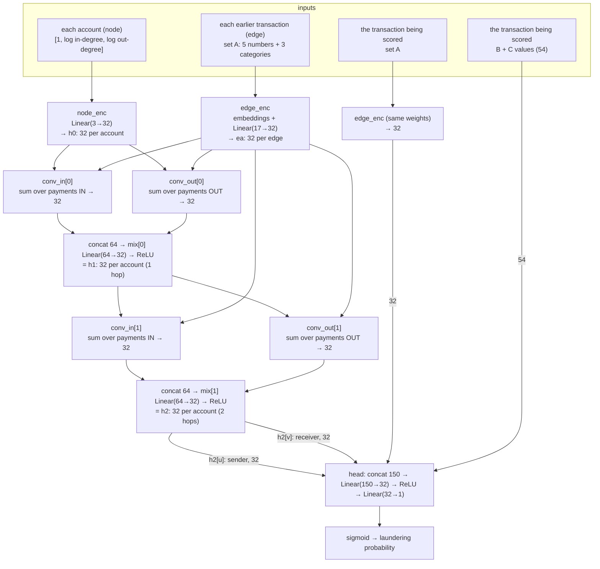

# The GNN model (`gnn/ABC`), explained and mapped to `src/gnn.py`

*Phase 3, T4–T5. Line numbers refer to [`src/gnn.py`](../src/gnn.py) as of 2026-10-30.*

## How to read the layer names

- **`Linear(a→b)`**: a layer of **b neurons**. Each neuron multiplies all **a** inputs by its own weights, adds them up plus a bias, and outputs one number. So `Linear(17→32)` turns 17 numbers into 32.
- **ReLU**: "negative becomes 0". It sits between linear layers so the network can learn curves and combinations, not just straight lines.
- **32** is the model's working width (the hidden size). Every account state and every encoded transaction is a vector of 32 numbers.

## The network

For one hour `h`: the graph holds the transactions of the **24 hours before `h`**, and the model scores every transaction **u → v** *in* hour `h` (u = sender account, v = receiver account).



Everything left of the head is the **graph part**. **`mlp/ABC` is the head alone**, without `h2[u]` and `h2[v]`, so it has 32 + 54 = 86 inputs.

| Block | Parameters (hidden 32) | Defined | Used in `forward` |
|---|---|---|---|
| `edge_enc` | 672 | `EdgeEncoder`, lines 90–98 | lines 115, 117 |
| `node_enc` | 128 | line 107 | line 117 |
| `conv_in` ×2 | 6,336 | lines 108–109 | line 119 |
| `conv_out` ×2 | 6,336 | line 110 | line 119 (`edge_index.flip(0)`) |
| `mix` ×2 | 4,160 | line 111 | line 119 |
| `head` | 4,865 | line 112 | lines 120–124 |
| **Total** | **22,497** | | |

All weights are **shared by every account and every transaction**. There is no per-account vector anywhere, so the model learns *how to read* a neighbourhood, not which accounts are dirty.

## Step by step

### 1. The graph for one hour (`snapshot`, `batch`)

- **Nodes** are accounts; **edges** are transactions, directed (who paid whom). It's a multigraph: ten payments u → v are ten edges. Self-transfers are self-loops.
- **`snapshot()`** (lines 65–70) takes edges with time in **[h − 24h, h)** as the graph and **[h, h + 1h)** as the targets. Line 70 **asserts** that every graph edge is strictly earlier than every target; `bench` checks this on all 425 hours.
- **`batch()`** (lines 75–85) keeps only the accounts this hour touches, renumbered 0..k−1 (line 77). It gives each account its start state `[1, log1p(in-degree), log1p(out-degree)]` within the 24h graph (line 81), and records the sender u and receiver v of each target (line 85).

### 2. `edge_enc`: a transaction's set A → 32 numbers (embeddings)

```
5 numbers   (log amount, hour, cross-bank, currency mismatch, self-transfer), scaled (line 97)
+ 4         payment format   → nn.Embedding(8, 4)
+ 4         paid currency    → nn.Embedding(16, 4)
+ 4         received currency→ the same currency table
= 17 numbers  ──Linear(17→32)──►  32 numbers
```

- **Why embeddings:** payment format and currency arrive as codes (ACH = 0, Bitcoin = 1, …). Fed in raw, the model would treat Cash (2) as "twice" Bitcoin (1), which is meaningless. An embedding is a **small learned lookup table**: every category gets its own 4 numbers, which start random and are adjusted by training. Categories that behave alike (Wire and Reinvestment both have zero laundering) tend to end up with similar vectors; ACH ends up far from them. It's the same as one-hot × a weight matrix, just smaller (12 dense numbers instead of 37 mostly zeros).
- **One currency table for both sides,** so "Euro" means the same whether paid or received.
- **These are category embeddings** (7 formats, 15 currencies, shared by everyone). Per-account embeddings stay banned.
- **Why scale and then `Linear(17→32)`:** log amounts are about 3 ± 1.5 and hours 0–23, so `(amount − 3) / 1.5` and `hour / 23` keep all inputs on similar scales (neural nets learn badly otherwise). The final linear layer maps them into the working width of 32. That's needed because messages add an edge vector to an account state (`h_j + W·e`), so both must have 32 numbers.
- **It runs twice:** on every edge in the graph (`ea`, line 117) and on the transaction being scored (line 115).

### 3. `node_enc`: an account's start state → 32 numbers

`[1, log in-degree, log out-degree]` → `Linear(3→32)` → **`h0`**, 32 numbers per account. That's all the model knows about an account before message passing: how busy it was in the last 24 hours, never who it is.

### 4. Layer 1: `conv_in[0]`, `conv_out[0]`, `mix[0]` → `h1`

- **`conv_in[0]`** looks at every payment **into** account i. Each one sends a message built from the payer's state and that payment, the messages are **summed**, and the result goes through a small network (the sum is explained below). Output: 32 numbers, "what came in".
- **`conv_out[0]`** does the same over payments **out of** i (the edges reversed). Output: 32 numbers, "what went out".
- **The 64:** the two 32-vectors are glued together (concat). It is *not* set A mixed with the node state. **`mix[0]`** = `Linear(64→32)` + ReLU turns them into **`h1`**: 32 numbers per account combining its start state, its incoming payments and its outgoing payments.

### 5. Layer 2: `conv_in[1]`, `conv_out[1]`, `mix[1]` → `h2`

The **second copies** of the same three layers, with **their own separate weights**. They do exactly the same thing, but start from `h1` instead of `h0`. Because each message now carries the payer's `h1`, which already summarizes *its* neighbours, **`h2[i]` reflects 2 hops**: "i received from accounts that had themselves just received from many others".

### 6. The head: 150 → 32 → 1

| Head input | Size | What | Why it's there |
|---|---|---|---|
| `h2[u]` | 32 | the sender's 2-hop neighbourhood state | graph context of who pays |
| `h2[v]` | 32 | the receiver's 2-hop neighbourhood state | graph context of who receives |
| `edge_enc(this transaction)` | 32 | its own set A, encoded | **it is not in its own graph** (the graph holds only earlier edges), so its amount, format and currencies must be given directly |
| B + C | 54 | its behaviour and graph-feature **values** (counts, sums, ratios), log-transformed and standardized on train rows (line 181) | the same columns LightGBM uses; plain input numbers, not neurons |
| **total** | **150** | | |

`Linear(150→32)` (32 neurons, each weighing all 150 inputs) → ReLU → `Linear(32→1)` (one neuron weighing those 32) → one number, the logit → **sigmoid** → probability between 0 and 1.

## The sum inside `conv_in` / `conv_out` (GINEConv)

For account `i` and every incoming payment `j → i` with encoded edge vector `e_ji`:

```
message from j   =  ReLU( h_j  +  W · e_ji )          W: Linear(32→32) inside GINEConv
sum              =  Σ  of the messages over all payments j → i
new state of i   =  MLP( h_i  +  sum )                MLP: Linear(32→32) → ReLU → Linear(32→32), line 108
```

`conv_out` is identical on the reversed edges, so its sum runs over i's outgoing payments.

- **Why a sum, not an average:** 40 incoming payments give a bigger sum than 2, so fan-in is visible. An average would hide how many there were. This is what lets GIN ("Graph Isomorphism Network") count neighbours.
- **Why two directions:** in-payments and out-payments are summed separately, so an account's state knows both "what came in" and "what went out": pass-through.
- **Why two layers:** each layer reaches one hop further.

## MLP vs GNN vs LightGBM

- **LightGBM** = gradient-boosted decision trees: 160 small trees of yes/no splits, added one at a time, each fixing what the earlier ones still get wrong. Strong on tabular data; handles raw scales, empty values and sharp thresholds (the "just under $20k" cliff) naturally.
- **MLP** (multilayer perceptron) = the plain neural network: layers of weighted sums with ReLU in between, all weights learned together by backpropagation. Needs inputs on similar scales; fits smooth curves. **`mlp/ABC` looks at one transaction in isolation** (its A + B + C).
- **GNN** = **the same MLP head plus `h2[u]` and `h2[v]`**: extra numbers carried along the edges from connected accounts, built from the same building blocks (linear layers, ReLU, sums) and learned together with the head. The model decides itself which parts of the neighbourhood matter, instead of us choosing the counts as in set C.

## Training (`train()`, lines 171–233)

1. **Setup:** standardize the 54 B + C inputs with **train-row** mean and std only (line 181); build the model (`mlp` = `use_graph=False`, line 184); loss = binary cross-entropy with laundering rows weighted ×100 (`POS_WEIGHT`, lines 20, 186), since they're about 1 in 1,000.
2. **One epoch** = all 144 train hours in time order (`run()`, lines 189–203). Per hour:
   - **forward:** build the hour's graph, score its ~19k transactions (line 195);
   - **backward:** `loss.backward()` (line 199) works out, for each of the 22,497 weights, how much it contributed to the error. It flows back through the head, into `h2[u]` and `h2[v]`, through layer 2's sums into the neighbours' `h1`, through layer 1, down to the encoders;
   - **step:** Adam nudges every weight a little (learning rate 0.001, line 200). Because weights are shared, every hour updates the same 22,497 numbers.
3. **After each epoch:** score the 48 val hours with no gradients and compute val PR-AUC. Keep the best weights; stop after 3 epochs without improvement, at most 30 (lines 207–216).
4. **Finish:** reload the best weights (line 218), score all 425 hours, check there are no NaNs and that val reproduces, then save to `data/models/{gnn,mlp}_ABC.pt` (line 225) and the `scores` table as `gnn/ABC` / `mlp/ABC` (line 233).
5. **Device:** CPU by default (`GNN_DEVICE`, line 177). On the 2 GB MX550 the GNN reserves 2.17 GB, spills into shared RAM, and runs 3.6× slower than the CPU (measured 2026-10-30).

## How the comparison isolates the graph

| Model | Sees | Compared with | Answers |
|---|---|---|---|
| `lgbm/ABC` | A + B + C, trees | `lgbm/AB` | Do hand-made graph features help? |
| `mlp/ABC` | A + B + C, the head with no graph | `lgbm/ABC` | Neural net vs trees, same inputs |
| `gnn/ABC` | A + B + C **plus** `h2[u]`, `h2[v]` | `mlp/ABC`, `lgbm/ABC` | Does *learned* 2-hop graph context add anything? |

- **`gnn/ABC − mlp/ABC`** = the effect of message passing alone: same head, same inputs, same training.
- **`mlp/ABC − lgbm/ABC`** = the effect of a neural net instead of trees.
