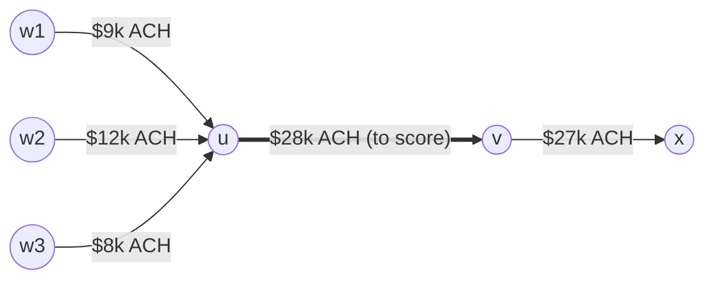
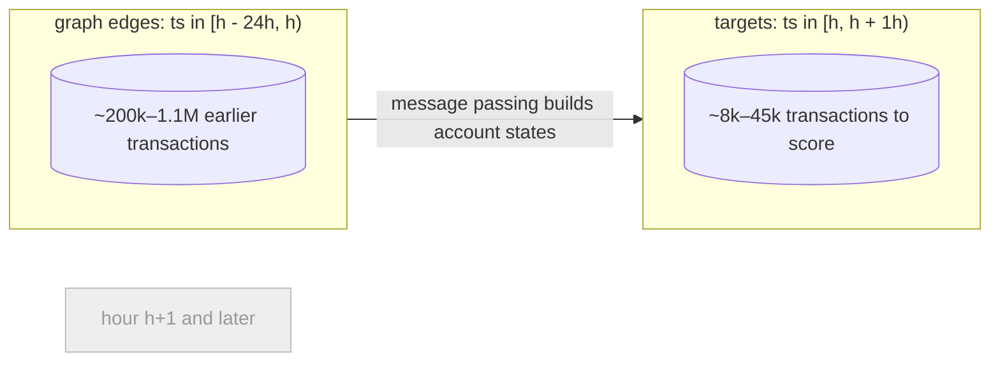
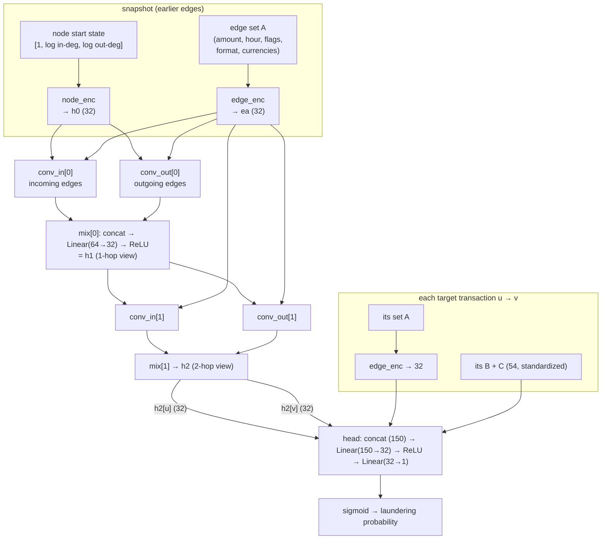
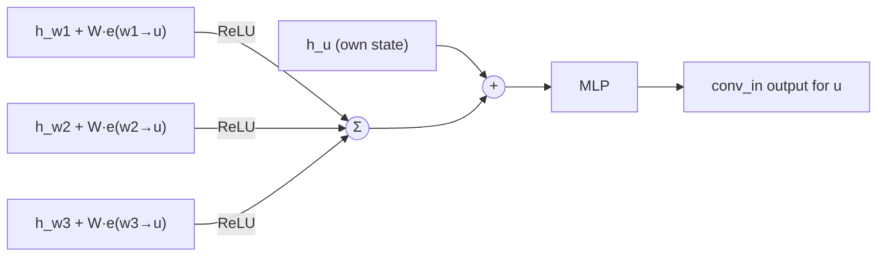
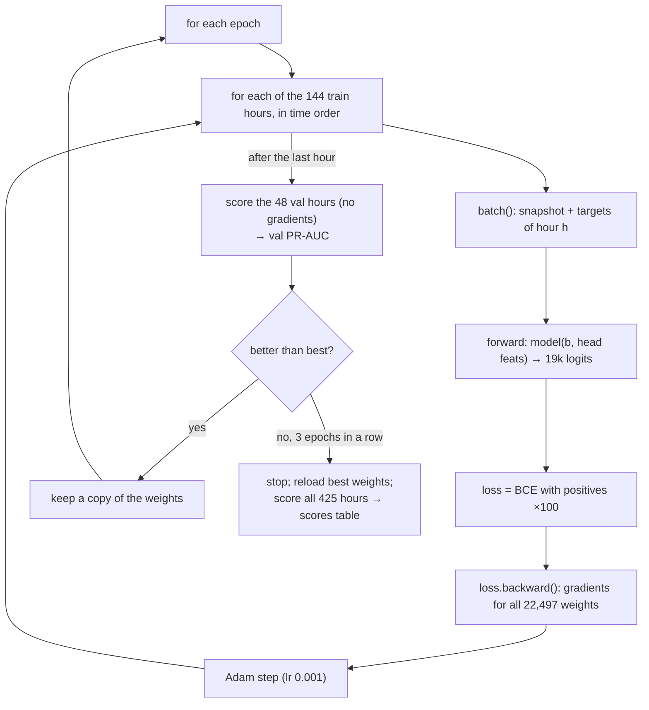

# The GNN model (`gnn/ABC`), explained and mapped to `src/gnn.py`

*Phase 3, T4–T5. Line numbers refer to [`src/gnn.py`](../src/gnn.py) as of 2026-10-30. The diagrams are Mermaid; GitHub and VS Code's Markdown preview render them.*

## 1. The data as a graph

- **Node** = an account (`bank:account`), 515,088 in total.
- **Edge** = one transaction u → v: directed, with its own time, amount and label. It's a **multigraph**: ten payments from u to v are ten edges. Self-transfers are self-loops.



*Read as: u received from three accounts (fan-in), then sends almost all of it on to v (pass-through). The GNN is meant to recognise shapes like this without being told the rule.*

| What | Where |
|---|---|
| Export all edges, sorted by time, accounts and categories as small integers | `export()`, lines 27–52 → `data/gnn/edges.npz` |
| The head's extra inputs: each transaction's B + C columns (54), `NULL → 0`, then `log1p` | `export()`, lines 54–60 → `data/gnn/head.npy` |
| What the model may read from an edge (set A only) | `EDGE_NUM`, `EDGE_CAT`, lines 22–23 |

`tx_id`, `split` and `label` are exported too, but they are never in `EDGE_NUM` / `EDGE_CAT`, so the model can't see them.

## 2. One hour = one snapshot (the leakage rule)

Transactions are scored hour by hour. For hour `h`, the graph holds only the edges of the **24 hours before** `h`. The transactions *of* hour `h` are the targets, and they are never part of their own graph.



| What | Where |
|---|---|
| Find both slices with binary search on the time-sorted edges | `snapshot()`, lines 64–70 |
| **Assert** every graph edge is strictly before every target | line 69, checked on all 425 hours by `bench` (lines 130–136) |
| Keep only the accounts this hour touches, renumbered 0..k−1 | `batch()`, line 76 |
| Node start state = `[1, log1p(in-degree), log1p(out-degree)]` in the snapshot | `batch()`, line 80 |
| Sender and receiver of each target | `target_index`, line 84 |

## 3. The network



| Block | Parameters (hidden 32) | Where defined | Where used in `forward` |
|---|---|---|---|
| `edge_enc`: Embedding(8→4) format, Embedding(16→4) currencies, Linear(17→32) | 672 | `EdgeEncoder`, lines 89–97 | lines 114, 116 |
| `node_enc`: Linear(3→32) | 128 | line 106 | line 116 |
| `conv_in` ×2: GINEConv over incoming edges | 6,336 | line 108 | line 118 |
| `conv_out` ×2: GINEConv over **reversed** edges | 6,336 | line 109 | line 118 (`edge_index.flip(0)`) |
| `mix` ×2: Linear(64→32) | 4,160 | line 110 | line 118 |
| `head`: Linear(150→32), ReLU, Linear(32→1) | 4,865 | line 111 | lines 119–123 |
| **Total** | **22,497** | | |

All weights are **shared by every account and transaction**. There is no per-account vector anywhere, so the model learns *how to read* a neighbourhood, not which accounts are dirty.

## 4. The sum: what one GINEConv layer does

For an account `i`, with incoming edges `j → i` carrying edge vectors `e_ji` (from `edge_enc`):

```
message from j   =  ReLU( h_j  +  W · e_ji )                  (W: Linear(32→32) inside GINEConv)
sum              =  Σ  over all incoming edges j → i   of the messages
new state of i   =  MLP( h_i  +  sum )                         (MLP: Linear → ReLU → Linear, line 107)
```



- **Why a sum and not an average:** 40 incoming payments give a bigger sum than 2, so fan-in is visible. An average would hide how many there were. That's what makes GIN ("Graph Isomorphism Network") able to count neighbours.
- **Why two directions:** `conv_in` sums over edges *into* u (who paid u); `conv_out` runs the same on reversed edges, so it sums over edges *out of* u (whom u paid). `mix` combines both, so u's state knows "what came in" and "what went out", which is pass-through.
- **Why two layers:** after layer 1, `h1[u]` summarises u's own transactions. Layer 2 sums *neighbours' `h1`*, so `h2[u]` also reflects the neighbours' neighbourhoods (2 hops: "u received from accounts that had just received from many others").

## 5. Training (backward pass)



| Step | Where |
|---|---|
| B + C head inputs standardized with **train-row** mean and std only | `train()`, line 179 |
| Model built; `mlp` = the same with `use_graph=False` (head gets 86 inputs: target edge + B + C) | line 182 |
| Loss: binary cross-entropy, positives weighted ×100 (`POS_WEIGHT`, line 19) | line 184 |
| One pass over hours: forward (line 193), then for training `zero_grad` / `backward` / `step` (lines 195–198) | `run()`, lines 187–201 |
| Epochs, val PR-AUC, early stopping (patience 3, max 30) | lines 205–215 |
| Reload the best epoch, score every split, check no NaNs and that val reproduces | lines 216–221 |
| Save weights to `data/models/{gnn,mlp}_ABC.pt` and scores to `scores` as `gnn/ABC` / `mlp/ABC` | lines 222–231 |

**What backward does:** the loss for one hour is differentiated back through the head, into `h2[u]` and `h2[v]`, back through layer 2's sums into the neighbours' `h1`, through layer 1, down to the encoders. Each weight gets nudged so that neighbourhoods like those of laundering transactions produce larger logits next time. Because the weights are shared, every hour's 19k transactions update the same 22,497 numbers.

## 6. How the comparison isolates the graph

| Model | Sees | Compared with | Answers |
|---|---|---|---|
| `lgbm/ABC` | A + B + C, trees | `lgbm/AB` | Do hand-made graph features help? |
| `mlp/ABC` | A + B + C, the same head with no graph | `lgbm/ABC` | Neural net vs trees on the same inputs |
| `gnn/ABC` | A + B + C **plus** `h2[u]`, `h2[v]` | `mlp/ABC`, `lgbm/ABC` | Does *learned* 2-hop graph context add anything? |

`gnn/ABC − mlp/ABC` is the effect of the message passing alone; everything else is identical.
