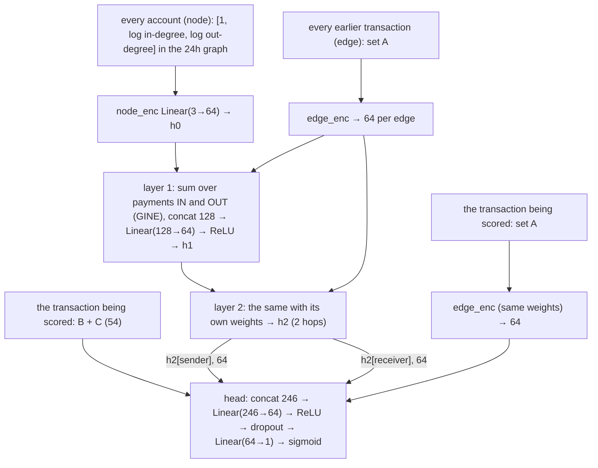

# Models

Every model scores single transactions: "how likely is this payment laundering?" They all see the same inputs (feature sets A, B and C, described in [`features.md`](features.md)), computed from strictly earlier transactions, and they are all trained on Sep 1–6, tuned on Sep 7–8 and tested once on Sep 9–10. Every model's score for every row is stored in the `scores` table as `model/feature_set` (e.g. `lgbm/ABC`), so any two can be compared on identical rows.

| Model | What it is | Code | Test PR-AUC |
|---|---|---|---|
| `is_ach` | Floor: flag every ACH payment | `train.py is_ach` | 0.006 |
| `lr/AB` | Logistic regression | `train.py lr AB` | 0.026 |
| `lgbm/A`, `lgbm/AB`, `lgbm/ABC` | LightGBM gradient-boosted trees | `train.py lgbm <set>` | 0.070 / 0.292 / 0.345 |
| `mlp_s0–s2/ABC` | Neural network on one transaction (3 seeds) | `gnn.py train <tag> name=mlp` | 0.368–0.371 |
| `gnn_s0–s2/ABC` | Our graph neural network (3 seeds) | `gnn.py train <tag>` | 0.372–0.379 |
| **`ens/ABC`** | **Ensemble: LightGBM + MLP** | `train.py ens` | **0.398** |

## LightGBM

Gradient-boosted decision trees: many small trees of yes/no splits ("is the receiver new?", "amount above $9,400?"), added one at a time, each correcting what the earlier ones still get wrong. It is strong on tabular data and handles raw scales, missing values ("no history") and sharp thresholds naturally.

- **Inputs:** the feature columns as they are. Payment format, currencies and hour are native categorical features, with categories fixed from the whole table so the codes are identical in every split.
- **Grid:** 8 runs over `num_leaves` {15, 63} × `learning_rate` {0.05, 0.1} × `min_child_samples` {50, 500}. Up to 2,000 trees, with early stopping after 100 rounds without improvement in **val average precision**.
- **Selection:** the run with the best val PR-AUC, ignoring runs that peak before 10 trees. Those are lucky single-tree fits with coarse, tie-heavy scores.
- **Chosen models:** `lgbm/AB`: 63 leaves, learning rate 0.05, min child 500, 237 trees. `lgbm/ABC`: 15 leaves, learning rate 0.05, min child 500, 160 trees.
- **Memory:** train and val are loaded separately, numerics as 32-bit floats, and all 5M rows are scored in chunks. That fits a 16 GB laptop.

`lgbm/ABC` is the **base model**: as good as anything at 500 alerts a day, explainable (below) and stable. `lgbm/AB` is the frozen baseline every later model is compared against.

## Logistic regression

The linear baseline: one-hot categories; set A standardized; set B log-transformed and standardized, with missing ratios set to 0 (the `has_history` flags mark them); balanced class weights. It scores 0.026 on test. The behavioural signal lives in thresholds and combinations a linear model can't express without hand-built bins.

## The MLP (neural network on one transaction)

A plain feed-forward network, **trained exactly like the GNN** (same code, same settings, same data order) but **without any graph**. It's the control that tells us what message passing adds.

```
set A of this transaction  ──edge_enc──►  64 numbers
B + C values (54)          ── standardized on train rows ──►  54 numbers
                                    concat 118 ──► Linear(118→64) ─► ReLU ─► dropout 0.1 ─► Linear(64→1) ─► sigmoid
```

- **`edge_enc`** turns set A into 64 numbers:
  - 5 numeric fields (log amount, hour, cross-bank, currency mismatch, self-transfer), each scaled to roughly −1..1;
  - payment format as a **learned 4-number embedding** (a small lookup table: each of the 7 formats gets its own 4 numbers, learned in training, so Cash isn't treated as "twice" Bitcoin);
  - paid and received currency through **one shared** currency embedding, so "Euro" means the same on both sides;
  - all 17 numbers then go through `Linear(17→64)`.
- **Size:** 8,929 weights.

## Our GNN (`gnn.py`)

A **GINE edge classifier with reverse message passing**, built for this project. It has the same head as the MLP, plus a learned summary of each account's neighbourhood. Its hyperparameters (learning rate, class weight, dropout, batch size) were taken from IBM's published Multi-GNN config, after our first settings trained too slowly; the architecture, data pipeline and training loop are our own.

### The graph, strictly past

For each hour `h`, the graph holds the transactions of the **24 hours before `h`**: accounts are nodes, payments are directed edges (a multigraph, so ten payments u → v are ten edges). The model scores every transaction **u → v** *in* hour `h`. An assert checks on every hour that each graph edge is strictly earlier than each scored transaction, and a deliberately leaky snapshot must fail it.

### The network (hidden size 64, 83,809 weights)



| Block | Weights | What it does |
|---|---|---|
| `edge_enc` | 1,248 | set A → 64 numbers (shared by graph edges and the scored transaction) |
| `node_enc` | 256 | an account's start state → 64 numbers |
| `conv_in` ×2 | 24,960 | GINE over payments **into** an account |
| `conv_out` ×2 | 24,960 | GINE over payments **out of** an account (edges reversed) |
| `mix` ×2 | 16,512 | concat in + out (128) → 64 per account |
| `head` | 15,873 | 246 → 64 → 1 |

- **GINE message passing:** each payment j → i sends `ReLU(h_j + W·e_ji)`; the messages are **summed** (so 40 incoming payments weigh more than 2, which makes fan-in visible), added to `h_i`, and passed through a small 2-layer network.
- **Reverse message passing:** incoming and outgoing payments are summed separately, so an account's state knows what came in *and* what went out (pass-through).
- **Two layers** reach two hops: "received from accounts that had themselves just received from many others".
- **All weights are shared** by every account and transaction. There is no per-account vector, so the model learns *how to read* a neighbourhood, never *which* accounts are dirty.
- **Why the scored transaction enters the head directly:** it isn't in its own graph (the graph holds only earlier edges), so its amount, format and currencies must be given explicitly.

### Training (MLP and GNN alike)

| Setting | Value |
|---|---|
| Loss | binary cross-entropy, laundering rows weighted ×6 |
| Optimizer | Adam, learning rate 0.006 |
| Updates | train hours in random order; within an hour, transactions in random chunks of 8,192, one update each (the graph is rebuilt per chunk because the weights change in between) |
| Regularization | dropout 0.01 after each message-passing layer, 0.1 before the last head layer |
| Gradient clipping | norm 1.0 (seed runs 1–2) |
| Model selection | val PR-AUC after every epoch; keep the best weights; stop after 10 epochs without improvement (at most 100), or when the training loss jumps above 10× its minimum (divergence) |
| Scaling | B + C inputs standardized with train-row mean and standard deviation only |
| Hardware | Colab T4 GPU: about 1.8 minutes per GNN epoch, 20 seconds per MLP epoch |

**Seeds:** each network was trained with 3 seeds and all three are reported, so no seed is picked on val. The GNN was **unstable** at this learning rate: 2 of 5 runs diverged mid-training even with clipping (Adam rescales steps, so clipping barely limits it). The MLP never diverged.

## Ensemble (`ens/ABC`)

An equal-weight average of two **ranks**:
1. each LightGBM (`lgbm/ABC`) score, converted to its percentile among LightGBM's own **training** scores;
2. the MLP score (mean over its 3 seeds), converted the same way.

Converting to percentiles puts a tree model and a neural net on the same scale. The mapping is fixed on training rows, so val and test can't move it, and the 50/50 weight was never tuned. The two models are strong on different schemes (LightGBM on fan-in and stack, the MLP on fan-out and gather-scatter), and the blend keeps most of both: test PR-AUC 0.398, significantly above both of its parts (LightGBM and each MLP seed).

## Explaining an alert (`explain.py`)

LightGBM's built-in TreeSHAP (`pred_contrib=True`) splits each alert's score into one contribution per feature, which add up exactly to the model's score. Features that encode the same fact (a new receiver has no pair history and no fan-in either) otherwise split credit into large opposite values. So contributions are **summed into 8 groups**:
- amount;
- payment format;
- account history;
- sender fan-out;
- pass-through;
- loop back to sender;
- currency and bank;
- time of day.

The top 3 groups become sentences built from the alert's own values. Examples: [`reports/phase4-alert-examples.md`](../reports/phase4-alert-examples.md).

## What the comparisons isolate

| Comparison | Same | Different | Answer on test |
|---|---|---|---|
| `lgbm/ABC` − `lgbm/AB` | model, grid | + graph features C | **+0.053**, significant |
| `mlp/ABC` − `lgbm/ABC` | inputs | neural net vs trees | +0.023 to +0.026 PR-AUC; tie at 500 alerts/day |
| `gnn/ABC` − `mlp/ABC` (per seed) | inputs, head, training | + message passing | +0.002 / +0.006 / +0.011, not significant |
| `ens/ABC` − its parts (`lgbm/ABC`, each MLP seed) | inputs | blend of trees + net | +0.027 to +0.053, significant |
